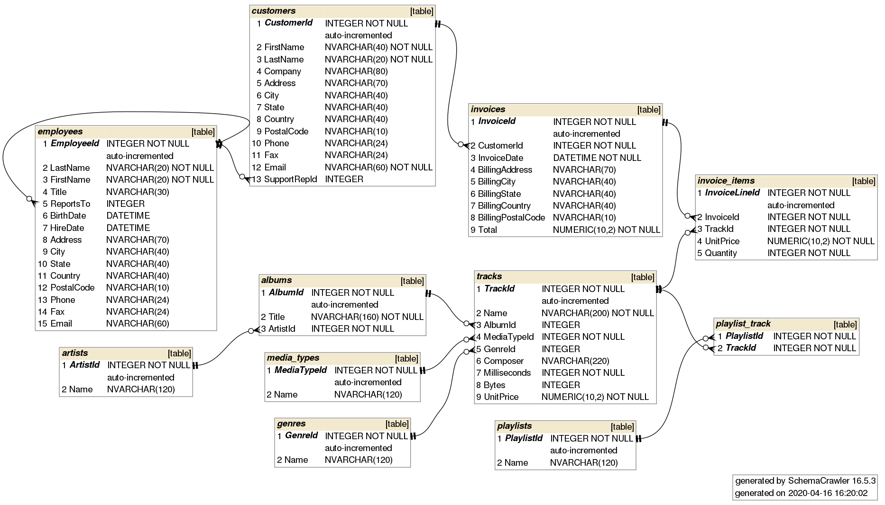
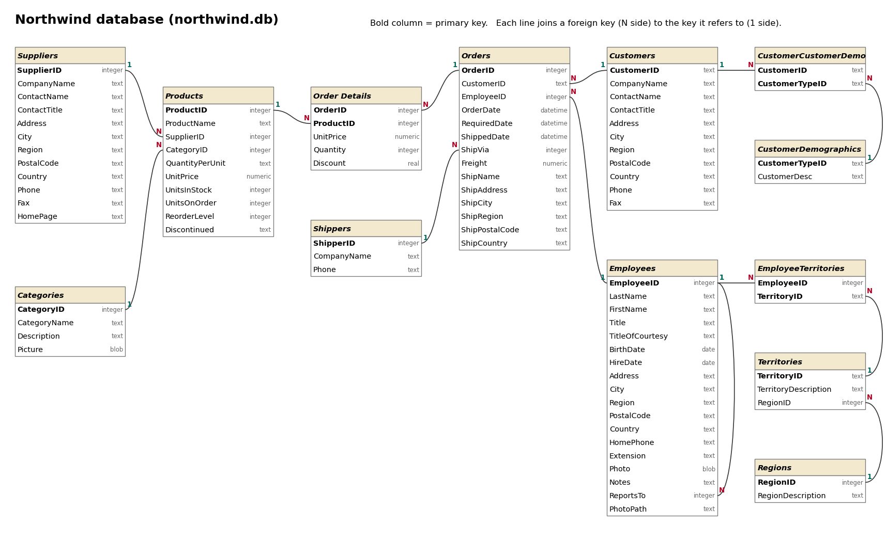

# DMA Quiz and Exam Reference: Python, NumPy, pandas and SQLite

This is the complete reference you can open during DMA (CSCI-UA 479) quizzes and exams in PrairieTest, gathered into one page so you can study from it beforehand. It combines every section from every quiz's and exam's reference page:

- every quiz shows the Python sections (Part 1);
- Quiz 6 adds NumPy (Part 2);
- Quizzes 7, 8 and 12 add pandas (Part 3);
- Quizzes 9, 10 and 11 add SQLite (Part 4);
- some quizzes also describe the dataset they use (Part 5);
- the final exam shows almost everything.

During a quiz you only see the sections for that quiz. Use your browser's find (Ctrl/Cmd + F) to search this page.

## Contents

**Part 1: Python**

- [1. Numbers and arithmetic](#1-numbers-and-arithmetic)
- [2. Strings](#2-strings)
- [3. Lists and tuples](#3-lists-and-tuples)
- [4. Conditions and loops](#4-conditions-and-loops)
- [5. Comprehensions](#5-comprehensions)
- [6. Dictionaries, sets and counting](#6-dictionaries-sets-and-counting)
- [7. Reading and writing files](#7-reading-and-writing-files)
- [8. Functions](#8-functions)
- [9. Useful built-in functions](#9-useful-built-in-functions)
- [10. Iterators and generators](#10-iterators-and-generators)
- [11. Decorators](#11-decorators)
- [12. reduce](#12-reduce)
- [13. SymPy: isprime](#13-sympy-isprime)
- [14. Errors and how to read them](#14-errors-and-how-to-read-them)
- [15. Classes](#15-classes)
- [16. JSON files, reading line by line, and statistics](#16-json-files-reading-line-by-line-and-statistics)

**Part 2: NumPy**

- [17. NumPy: creating arrays](#17-numpy-creating-arrays)
- [18. NumPy: selecting rows, columns and cells](#18-numpy-selecting-rows-columns-and-cells)
- [19. NumPy: arithmetic and matrix multiplication](#19-numpy-arithmetic-and-matrix-multiplication)
- [20. NumPy: sums and other totals](#20-numpy-sums-and-other-totals)
- [21. NumPy: looping over a grid](#21-numpy-looping-over-a-grid)
- [22. NumPy: other useful functions](#22-numpy-other-useful-functions)

**Part 3: pandas**

- [23. pandas: reading data and choosing columns](#23-pandas-reading-data-and-choosing-columns)
- [24. pandas: filtering rows and selecting by position](#24-pandas-filtering-rows-and-selecting-by-position)
- [25. pandas: calculations and new columns](#25-pandas-calculations-and-new-columns)
- [26. pandas: sorting](#26-pandas-sorting)
- [27. pandas: merging two DataFrames](#27-pandas-merging-two-dataframes)
- [28. pandas: grouping](#28-pandas-grouping)
- [29. pandas: JSON files and list columns](#29-pandas-json-files-and-list-columns)

**Part 4: SQLite**

- [30. SQLite in the quizzes and exams](#30-sqlite-in-the-quizzes-and-exams)
- [31. SQLite: SELECT, WHERE, ORDER BY and LIMIT](#31-sqlite-select-where-order-by-and-limit)
- [32. SQLite: totals, GROUP BY and HAVING](#32-sqlite-totals-group-by-and-having)
- [33. SQLite: joining tables](#33-sqlite-joining-tables)
- [34. SQLite: subqueries](#34-sqlite-subqueries)
- [35. SQLite: window functions](#35-sqlite-window-functions)

**Part 5: Datasets used in the quizzes**

- [36. stem_gender.csv: columns](#36-stem_gendercsv-columns)
- [37. books_data.json: fields](#37-books_datajson-fields)
- [38. Chinook database (chinook.db)](#38-chinook-database-chinookdb)
- [39. Northwind database (northwind.db)](#39-northwind-database-northwinddb)

## Part 1: Python

### 1. Numbers and arithmetic

Python has two main kinds of numbers: *integers* (`int`), which are whole numbers of any size, and *floating-point numbers* (`float`), which have a decimal point. Integers never overflow in Python, so you can compute very large values exactly.

There are two kinds of division. The `/` operator always produces a float, even when the result is a whole number. The `//` operator performs *floor division*: it divides and rounds down to an integer. The `%` operator gives the *remainder* after division, which makes it the standard way to test divisibility: `n % k == 0` is true exactly when `k` divides `n` evenly. Exponentiation uses `**`.

```python
7 / 2        # 3.5
6 / 2        # 3.0   (still a float)
7 // 2       # 3
7 % 2        # 1     (so 7 is odd)
10 % 5 == 0  # True  (5 divides 10)
2 ** 10      # 1024
```

Comparisons (`==`, `!=`, `<`, `<=`, `>`, `>=`) produce `True` or `False`, and can be chained, so `0 <= x < 10` checks that `x` lies in a range. Combine conditions with `and`, `or` and `not`. Note that `=` assigns a value while `==` tests equality.

To convert between types, call the type as a function: `int("42")` turns text into an integer, `float("3.5")` into a float, and `str(10)` turns a number into text. `round(x, n)` rounds to `n` decimal places, and `abs(x)` gives the absolute value. Shorthand operators such as `x += 1` update a variable in place (also `-=`, `*=`, `//=` and so on).

#### The math module

More mathematical functions live in the `math` module, which you import once at the top of your program.

```python
import math
math.sqrt(16)          # 4.0   (square root, as a float)
math.isqrt(17)         # 4     (integer square root, rounded down)
math.floor(2.7)        # 2
math.ceil(2.1)         # 3
math.gcd(12, 18)       # 6     (greatest common divisor)
math.prod([2, 3, 4])   # 24    (product of a sequence)
math.inf               # a value larger than any number
```

### 2. Strings

A string is a sequence of characters, written in single or double quotes. You can find its length with `len`, look up individual characters by position, and loop over its characters with `for ch in s:`. Positions (*indexes*) start at 0; negative indexes count from the end, so `s[-1]` is the last character.

A *slice* `s[start:end]` extracts part of a string. The start position is included and the end position is excluded, so `s[1:4]` has three characters. Either end can be omitted to mean "from the beginning" or "to the end". A third number sets the step, and a step of `-1` walks backwards, which reverses the string.

```python
s = "hello world"
len(s)          # 11
s[0], s[-1]     # 'h', 'd'
s[1:4]          # 'ell'
s[:5], s[6:]    # 'hello', 'world'
s[::-1]         # 'dlrow olleh'
```

Strings are *immutable*: you cannot change one in place. Methods such as `upper` or `replace` return a new string and leave the original unchanged, so remember to use or store the result. The `in` operator tests whether one string appears inside another.

```python
"lo" in s                 # True
s.upper(), s.lower()      # 'HELLO WORLD', 'hello world'
s.startswith("he")        # True
s.endswith("ld")          # True
s.find("o")               # 4   (position of the first match, or -1)
s.count("o")              # 2
s.replace("o", "0")       # 'hell0 w0rld'
"  hi\n".strip()          # 'hi'  (removes surrounding whitespace)
"abc".isalpha()           # True (all letters)
"123".isdigit()           # True (all digits)
```

#### Splitting and joining

`split` breaks a string into a list of pieces. With no argument it splits on any run of whitespace (spaces, tabs, newlines), which is the usual way to separate words or numbers on a line. Give it a separator to split on something else. `join` does the reverse: it is called on the separator and glues a list of strings together.

```python
"one two  three".split()     # ['one', 'two', 'three']
"a,b,c".split(",")           # ['a', 'b', 'c']
"-".join(["a", "b", "c"])    # 'a-b-c'
```

#### Formatting output

An *f-string* (a string with an `f` before the opening quote) lets you insert values directly into text by writing expressions inside braces. A format code after a colon controls how a number is shown.

```python
name, n = "Ann", 3
f"{name} has {n} items"   # 'Ann has 3 items'
f"{3.14159:.2f}"          # '3.14'       (two decimal places)
f"{1234567:,}"            # '1,234,567'  (thousands separators)
```

### 3. Lists and tuples

A list holds an ordered collection of values, written in square brackets. Lists use the same indexing and slicing rules as strings, but unlike strings they are *mutable*: you can add, remove and change items. Lists can hold any mix of values, including other lists.

```python
xs = [3, 1, 4, 1, 5]
xs[0], xs[-1]      # 3, 5
xs[1:3]            # [1, 4]
xs[0] = 9          # replace an item
len(xs), sum(xs), min(xs), max(xs)
```

The most common way to build a list is to start with an empty list and `append` items one at a time inside a loop. Other methods insert, remove or search for items. Note that `xs.sort()` sorts the list *in place* and returns `None`, whereas the built-in function `sorted(xs)` returns a new sorted list and leaves the original alone.

```python
result = []
for x in xs:
    result.append(x * 10)

xs.extend([2, 6])      # add several items to the end
xs.insert(0, 7)        # insert 7 at position 0
xs.pop()               # remove and return the last item
xs.remove(1)           # remove the first occurrence of 1
xs.index(4)            # position of the first 4
xs.count(1)            # how many times 1 appears
xs.sort()              # sort in place
sorted(xs, reverse=True)     # new list, largest first
sorted(words, key=len)       # new list, ordered by length
```

A list of lists represents a table: `grid[r]` is a row and `grid[r][c]` a single cell. `[0] * 3` creates a list of three zeros.

#### Tuples

A tuple is like a list but immutable, written with parentheses. Tuples are often used to group a few related values. *Unpacking* assigns the parts of a tuple (or list) to separate variables in one step, which also gives a neat way to swap two variables.

```python
point = (3, 4)
x, y = point      # x is 3, y is 4
a, b = b, a       # swap a and b
```

### 4. Conditions and loops

Python uses *indentation* to group statements: everything indented under an `if`, `for`, `while` or `def` line belongs to it. Use a consistent indent (four spaces is standard). An `if` statement can be followed by any number of `elif` branches and an optional `else`; the first branch whose condition is true runs.

```python
if x > 0:
    print("positive")
elif x == 0:
    print("zero")
else:
    print("negative")
```

#### for loops

A `for` loop runs once for each item in a sequence such as a list, a string, the lines of a file, or a `range`. `range(stop)` counts from 0 up to but not including `stop`; `range(start, stop, step)` lets you choose the start and step, and a negative step counts down.

```python
for i in range(5):           # 0, 1, 2, 3, 4
for i in range(2, 10, 3):    # 2, 5, 8
for i in range(10, 0, -1):   # 10, 9, ..., 1
for ch in "abc":             # 'a', 'b', 'c'
```

When you need both the position and the item, use `enumerate`. To walk through two sequences side by side, use `zip`, which stops at the end of the shorter one.

```python
for i, name in enumerate(["a", "b"]):   # (0, 'a'), (1, 'b')
    print(i, name)
for x, y in zip([1, 2], [10, 20]):      # (1, 10), (2, 20)
    print(x + y)
```

#### while loops

A `while` loop repeats as long as its condition stays true. It is the natural choice when you do not know in advance how many steps you need, for example when you keep going until a value passes some limit. Make sure something inside the loop eventually makes the condition false, or the loop will run forever.

```python
n = 1
while n < 1000:
    n = n * 2
print(n)   # 1024
```

Inside either kind of loop, `break` leaves the loop immediately and `continue` skips the rest of the current pass and moves on to the next one. A loop may also have an `else` block, which runs only if the loop ended without hitting `break`; this is handy for "search, and do something if nothing was found".

### 5. Comprehensions

A *list comprehension* builds a new list from an existing sequence in a single expression. It reads like a sentence: "the value, for each item in the sequence, if a condition holds". It is equivalent to an empty list plus a loop that appends, but shorter and usually clearer.

```python
nums = [1, 2, 3, 4, 5, 6]
[x * x for x in nums]            # [1, 4, 9, 16, 25, 36]
[x for x in nums if x % 2 == 0]  # [2, 4, 6]  (keep only even numbers)

# the same as the second comprehension, written as a loop:
evens = []
for x in nums:
    if x % 2 == 0:
        evens.append(x)
```

You can combine several conditions with `and`/`or`, use a conditional expression to choose between two values, and include more than one `for` clause (the first one is the outer loop). The same syntax with braces builds a set or a dictionary, and with no brackets at all inside a function call it produces values one at a time, which works well with `sum`, `min`, `max`, `any` and `all`.

```python
["big" if x > 3 else "small" for x in nums]
[(i, j) for i in range(2) for j in range(3)]   # 6 pairs
{w: len(w) for w in ["hi", "hello"]}          # {'hi': 2, 'hello': 5}
sum(x * x for x in nums)                       # 91
```

### 6. Dictionaries, sets and counting

A *dictionary* maps keys to values, like a lookup table. Keys are usually strings or numbers and must be unique; looking up a key is fast no matter how large the dictionary is. Reading a key that is not present raises a `KeyError`, so use `get` with a default when a key might be missing. Looping over a dictionary gives its keys; use `items()` to get key–value pairs.

```python
ages = {"ann": 20, "bob": 22}
ages["cat"] = 19          # add a new key (or update an existing one)
ages["ann"]               # 20
ages.get("dan", 0)        # 0  (default because "dan" is missing)
"bob" in ages             # True  (tests the keys)
for name, age in ages.items():
    print(name, age)
max(ages, key=ages.get)   # the key with the largest value: 'bob'
```

A common pattern is counting: start each count at zero the first time you see a key, then add one. The `Counter` class in the `collections` module does this for you, and `defaultdict` creates a starting value automatically for missing keys.

```python
counts = {}
for w in ["a", "b", "a"]:
    counts[w] = counts.get(w, 0) + 1     # {'a': 2, 'b': 1}

from collections import Counter, defaultdict
Counter("banana")                   # Counter({'a': 3, 'n': 2, 'b': 1})
Counter("banana").most_common(1)    # [('a', 3)]
groups = defaultdict(list)
groups["x"].append(1)               # no need to create the list first
```

#### Sets

A *set* is an unordered collection with no duplicates. Converting a sequence to a set removes repeats, so `len(set(xs))` counts the distinct values. Sets support fast membership tests and the usual set operations.

```python
s = set("banana")     # {'b', 'a', 'n'}
s.add("z")
a = {1, 2, 3}; b = {2, 3, 4}
a | b                 # {1, 2, 3, 4}  union
a & b                 # {2, 3}        intersection
a - b                 # {1}           difference
```

### 7. Reading and writing files

`open` opens a file by name. Use it in a `with` statement, which closes the file automatically when the indented block ends. In the quiz, data files are in the same directory as your program, so the plain file name is enough.

There are three common ways to read a text file. `f.read()` returns the whole file as one string. `f.read().splitlines()` returns a list of lines without their line-ending characters. Looping with `for line in f:` reads one line at a time; each line then still ends with `"\n"`, so call `strip()` before using it.

```sql
with open("words.txt") as f:
    text = f.read()                  # one string

with open("words.txt") as f:
    lines = f.read().splitlines()    # list of lines

with open("words.txt") as f:
    for line in f:
        word = line.strip()          # remove the trailing newline
        print(word)
```

Everything read from a file is text. To work with numbers, split each line into pieces and convert each piece with `int` or `float`. A comprehension does this neatly.

```python
line = "3 7 12"
nums = [int(x) for x in line.split()]    # [3, 7, 12]
"4,5,6".split(",")                       # use a separator for comma-separated data
```

To write a file, open it with mode `"w"` (which replaces any existing contents) and call `write`; unlike `print`, it does not add a newline for you.

```sql
with open("out.txt", "w") as f:
    f.write("first line\n")
```

### 8. Functions

A function packages a piece of code under a name so you can reuse it. Define it with `def`, list its parameters in parentheses, and use `return` to send a result back to the caller. A function without a `return` statement returns `None`. Parameters can have default values, and callers can pass arguments by name.

```python
def area(width, height=1):
    return width * height

area(3)                    # 3
area(3, 4)                 # 12
area(width=3, height=4)    # 12
```

Writing a small helper function that answers one yes/no question (returning `True` or `False`) often makes a program easier to read and test. A function can return several values at once by returning a tuple, which the caller can unpack.

```python
def is_even(n):
    return n % 2 == 0

def lowest_and_highest(values):
    return min(values), max(values)

lo, hi = lowest_and_highest([3, 1, 4])   # 1, 4
```

A `lambda` is a small unnamed function written in one expression. It is mostly used as the `key` argument to `sorted`, `min` and `max`, which tells them what to compare.

```python
pairs = [("a", 3), ("b", 1)]
sorted(pairs, key=lambda p: p[1])    # [('b', 1), ('a', 3)]
```

### 9. Useful built-in functions

These functions are always available without an import.

|   |   |
|---|---|
| `print(a, b, sep=", ", end="")` | Prints values separated by `sep` (a space by default) and followed by `end` (a newline by default). Printing a list shows it in brackets, e.g. `[1, 2]`. |
| `len(x)` | Number of items in a string, list, set or dictionary. |
| `sum`, `min`, `max` | Total, smallest and largest item. `min` and `max` accept `key=` to compare by something else, and `default=` for an empty sequence. |
| `sorted(x, key=..., reverse=...)` | Returns a new sorted list. |
| `range(start, stop, step)` | A sequence of integers; `stop` is not included. |
| `enumerate(x)`, `zip(a, b)` | Index–item pairs; items from two sequences side by side. `zip(*rows)` turns a list of rows into columns. |
| `any(x)`, `all(x)` | True if at least one item / every item is true. |
| `list`, `tuple`, `set`, `dict` | Create an empty collection or convert another sequence. |
| `map(f, x)`, `filter(f, x)` | Apply `f` to every item / keep the items for which `f` is true. Wrap in `list()` to see the result. |
| `divmod(a, b)` | Quotient and remainder together: `divmod(7, 2)` is `(3, 1)`. |
| `type(x)`, `isinstance(x, int)` | Check what kind of value you have. |

### 10. Iterators and generators

An *iterable* is anything a `for` loop can walk through: lists, strings, ranges, dictionaries, files and more. Behind the scenes, the loop asks the iterable for an *iterator*, an object that hands out one item at a time and remembers where it is. You can do the same by hand with `iter` and `next`; when there are no items left, `next` raises `StopIteration`, which is how a `for` loop knows to stop.

```python
it = iter(["a", "b"])
next(it)      # 'a'
next(it)      # 'b'
next(it)      # raises StopIteration
next(it, None)   # a default instead of an error when exhausted
```

An iterator can only be used once: after it has been run to the end it stays empty. If you need the values again, store them in a list with `list(...)`.

#### Generator functions

A *generator function* is an easy way to write your own iterator. It looks like an ordinary function but uses `yield` instead of `return`. Calling it does not run the body; it returns a generator. Each time the generator is asked for a value, the function runs until the next `yield`, hands that value out, and pauses there, keeping all its local variables, until the next value is requested. When the function ends, the generator is exhausted.

```python
def countdown(n):
    while n > 0:
        yield n
        n -= 1

for x in countdown(3):
    print(x)            # 3, 2, 1
list(countdown(4))      # [4, 3, 2, 1]
```

Because values are produced only when needed, a generator can describe a very long or even endless sequence without storing it in memory. Just make sure the code that consumes an endless generator stops, for example with `break`.

```python
def squares():
    n = 1
    while True:          # endless
        yield n * n
        n += 1

for sq in squares():
    if sq > 50:
        break
    print(sq)            # 1, 4, 9, 16, 25, 36, 49
```

#### Generator expressions

A generator expression is a comprehension written with parentheses instead of square brackets. It produces its values lazily, one at a time, instead of building a list first. Inside a function call you can leave out the extra parentheses.

```python
gen = (x * x for x in range(5))
sum(gen)                           # 30
max(len(w) for w in ["hi", "hello"])   # 5
```

#### The itertools module

The `itertools` module has building blocks for working with iterators.

```python
import itertools
itertools.count(10)                  # 10, 11, 12, ... forever
itertools.islice(squares(), 3)       # the first 3 values: 1, 4, 9
itertools.takewhile(lambda x: x < 20, squares())   # 1, 4, 9, 16
itertools.chain([1, 2], [3])         # 1, 2, 3
itertools.combinations("abc", 2)     # ('a','b'), ('a','c'), ('b','c')
itertools.permutations("ab")         # ('a','b'), ('b','a')
```

These return iterators; wrap them in `list(...)` to see all the values at once.

### 11. Decorators

In Python, functions are values: you can store them in variables, pass them to other functions, and return them from functions. A *decorator* uses this to wrap extra behaviour around a function without changing its code. A decorator is a function that takes a function and returns a new function, usually one that does something before and/or after calling the original.

```python
def shout(func):
    def wrapper(*args, **kwargs):
        result = func(*args, **kwargs)
        return result.upper()
    return wrapper

@shout
def greet(name):
    return "hello " + name

greet("ann")      # 'HELLO ANN'
```

Writing `@shout` above the definition is shorthand for `greet = shout(greet)`: the name `greet` now refers to the wrapper. The wrapper uses `*args` and `**kwargs` to accept whatever arguments the original function takes and pass them through unchanged.

A decorator that takes its own arguments needs one more layer: an outer function that receives the arguments and returns the actual decorator.

```python
def repeat(times):
    def decorator(func):
        def wrapper(*args, **kwargs):
            for _ in range(times):
                func(*args, **kwargs)
        return wrapper
    return decorator

@repeat(2)
def hi():
    print("hi")

hi()      # prints "hi" twice
```

Python also has useful built-in decorators. `functools.cache` remembers the results of earlier calls so a function never computes the same answer twice, which can make recursive functions dramatically faster. `functools.wraps`, used inside a decorator, keeps the original function's name and documentation on the wrapper.

```python
from functools import cache

@cache
def slow_square(n):
    print("computing", n)
    return n * n

slow_square(4)    # prints "computing 4", returns 16
slow_square(4)    # returns 16 straight from the cache
```

### 12. reduce

`reduce`, from the `functools` module, combines all the items of a sequence into a single value by applying a two-argument function over and over. It starts with the first two items, then combines that result with the third item, and so on, like a running total.

```python
from functools import reduce

reduce(lambda a, b: a + b, [1, 2, 3, 4])    # ((1 + 2) + 3) + 4 = 10
reduce(lambda a, b: a * b, [1, 2, 3, 4])    # 24
reduce(lambda a, b: a if a > b else b, [3, 9, 2])   # 9
```

An optional third argument gives a starting value. It is used as the first "running result", and it is also what `reduce` returns for an empty sequence (without it, an empty sequence raises a `TypeError`).

```python
reduce(lambda a, b: a + b, [], 0)             # 0
reduce(lambda acc, w: acc + len(w), ["hi", "hey"], 0)   # 5
```

For common cases a built-in is simpler: `sum`, `max`, `min`, `math.prod`, `any` and `all` are all reductions. The `operator` module provides named versions of the operators, e.g. `reduce(operator.mul, nums)`.

### 13. SymPy: isprime

SymPy is a library for symbolic mathematics. Its `isprime` function tells you whether an integer is a prime number (a whole number greater than 1 whose only divisors are 1 and itself). It returns `True` or `False` and is fast even for very large numbers.

```python
from sympy import isprime

isprime(7)      # True
isprime(8)      # False
isprime(1)      # False  (1 is not prime)
isprime(2)      # True   (2 is the only even prime)
```

Because it returns a boolean, `isprime` fits naturally into an `if` statement or the condition of a comprehension.

```python
[n for n in [10, 11, 12, 13] if isprime(n)]   # [11, 13]
```

### 14. Errors and how to read them

When something goes wrong, Python stops and prints a *traceback*. Read it from the bottom up: the last line names the kind of error and gives a short message, and the lines above show where in your program it happened, with the line number.

|   |   |
|---|---|
| `SyntaxError`, `IndentationError` | The code is not valid Python: look for a missing colon, bracket or quote, or inconsistent indentation. |
| `NameError` | A variable or function name is misspelled or used before it is defined. |
| `TypeError` | An operation got the wrong kind of value, e.g. `"a" + 1`; convert with `str` or `int`. |
| `ValueError` | The right type but an unusable value, e.g. `int("abc")`. |
| `IndexError` | A list or string position past the end; remember indexes start at 0. |
| `KeyError` | A dictionary key that is not present; use `in` or `.get`. |
| `ZeroDivisionError` | Division or `%` by zero. |
| `FileNotFoundError` | The file name is wrong or the file is not in the current directory. |

You can handle an error you expect instead of letting the program stop, by putting the risky code in a `try` block and saying what to do in an `except` block.

```python
try:
    value = int(text)
except ValueError:
    value = 0
```

### 15. Classes

A *class* describes a kind of object. `__init__` runs when you create an object and stores its attributes on `self`. A *method* is a function in a class, and its first parameter is always `self`, the object it was called on. A method can return a new object of the same class. `__str__` sets what `print` shows. A class can inherit from another, and `super().__init__(...)` calls the parent's `__init__`.

```python
class Point:
    def __init__(self, x, y):
        self.x = x
        self.y = y

    def distance(self, other):
        return ((self.x - other.x) ** 2 + (self.y - other.y) ** 2) ** 0.5

    def __str__(self):
        return f"({self.x}, {self.y})"

p = Point(0, 0)
q = Point(3, 4)
p.distance(q)      # 5.0
print(q)           # (3, 4)

class Point3D(Point):
    def __init__(self, x, y, z):
        super().__init__(x, y)
        self.z = z
```

### 16. JSON files, reading line by line, and statistics

`json.load` reads a JSON file into Python lists and dictionaries. When a key may be missing, `get` lets you supply a default value instead of causing an error.

```python
import json
with open("bios.json") as f:
    people = json.load(f)        # a list of dictionaries

first = people[0]
first["name"]["last"]            # a value inside a nested dictionary
first.get("awards", [])          # the value, or [] if the key is missing
[len(p.get("awards", [])) for p in people]   # the number of awards per person
```

`readline` reads one line from an open file, which is a common way to skip a header row.

```python
f = open("data.csv", "r")
f.readline()                     # read one line, here to skip the header
for line in f:
    fields = line.split(",")     # the remaining lines, one at a time
f.close()
```

The `statistics` module has common summary functions.

```python
import statistics
statistics.mean([1, 2, 3])       # 2
statistics.median([1, 2, 3, 4])  # 2.5
statistics.stdev([1, 2, 3])      # 1.0  (sample standard deviation)
```

## Part 2: NumPy

### 17. NumPy: creating arrays

Import NumPy once at the top of your program. An *array* is a grid of numbers. A two-dimensional array has rows and columns, and `.shape` gives its size as `(rows, columns)`.

```python
import numpy as np
np.array([1, 2, 3])            # a one-dimensional array
np.array([[1, 2], [3, 4]])     # two rows, two columns
np.zeros((2, 3))               # 2 rows, 3 columns of 0.0
np.ones((2, 3))                # 2 rows, 3 columns of 1.0
np.zeros((2, 3), dtype=int)    # the same zeros, as integers
np.arange(2, 10, 2)            # [2 4 6 8]  (the stop value is excluded)
```

`reshape` arranges the same values into a new shape, filling one row at a time. The total number of values must stay the same.

```python
A = np.arange(1, 7).reshape((2, 3))
# [[1 2 3]
#  [4 5 6]]
A.shape      # (2, 3)
A.T          # the transpose: rows become columns
B = A.copy() # a separate copy of A
```

### 18. NumPy: selecting rows, columns and cells

Rows and columns are numbered from 0, so the first row is row 0 and the 3rd column is column 2. Inside the brackets, the row comes first and the column second. A colon on its own means "all of them".

```python
A = np.arange(1, 13).reshape((3, 4))
# [[ 1  2  3  4]
#  [ 5  6  7  8]
#  [ 9 10 11 12]]
A[1, 2]        # 7              (row 1, column 2)
A[1, :]        # [5 6 7 8]      (row 1)
A[:, 2]        # [ 3  7 11]     (column 2)
A[0:2, 1:3]    # rows 0-1, columns 1-2: [[2 3] [6 7]]
A[::-1]        # the rows in reverse order
A[:, ::-1]     # the columns in reverse order
```

You can select several rows or columns at once with a list of indexes, and assign to any selection to change those values in the array.

```python
A[[0, 2], :]     # rows 0 and 2
A[:, [1, 3]]     # columns 1 and 3
A[:, 2] = 0      # set all of column 2 to 0
A[[0, 2], :] *= 3    # triple rows 0 and 2
```

### 19. NumPy: arithmetic and matrix multiplication

The usual operators work *element by element*: `A * 3` multiplies every value by 3, and `A * B` multiplies matching values. For *matrix multiplication* use the `@` operator instead. The number of columns of the first matrix must equal the number of rows of the second.

```python
A = np.array([[1, 2], [3, 4]])
B = np.array([[0, 1], [1, 0]])
A * 3      # [[ 3  6] [ 9 12]]   (every element times 3)
A + B      # [[1 3] [4 4]]       (element by element)
A * B      # [[0 2] [3 0]]       (element by element)
A @ B      # [[2 1] [4 3]]       (matrix multiplication)
A.T @ A    # [[10 14] [14 20]]   (transpose of A times A)
```

With *broadcasting*, NumPy stretches arrays of different shapes so that they match. Here a column of 3 values times a row of 3 values gives a 3 by 3 multiplication table.

```python
r = np.array([1, 2, 3])
r.reshape((3, 1)) * r.reshape((1, 3))    # [[1 2 3] [2 4 6] [3 6 9]]
```

### 20. NumPy: sums and other totals

With no argument, `sum`, `max`, `min` and `mean` use the whole array. With `axis=0` the answer has one value per column, and with `axis=1` it has one value per row. `cumsum` gives running totals.

```python
A = np.array([[1, 2, 3], [4, 5, 6]])
A.sum()           # 21
A.sum(axis=0)     # [5 7 9]    (one total per column)
A.sum(axis=1)     # [ 6 15]    (one total per row)
A.max(), A.min()  # 6, 1
A.mean()          # 3.5
np.array([1, 2, 3]).cumsum()    # [1 3 6]
A.cumsum(axis=0)  # running totals down each column: [[1 2 3] [5 7 9]]
A.cumsum(axis=1)  # running totals across each row: [[1 3 6] [4 9 15]]
int(A.sum())      # 21 as an ordinary Python integer
```

### 21. NumPy: looping over a grid

To visit every cell, use two nested loops over the row and column numbers. Before you look at a neighbouring cell, check that its row and column are inside the grid, because a negative index counts from the end instead of causing an error.

```python
rows, cols = A.shape
for r in range(rows):
    for c in range(cols):
        print(r, c, A[r, c])

if 0 <= r2 < rows and 0 <= c2 < cols:
    print(A[r2, c2])
```

### 22. NumPy: other useful functions

```python
np.diag([1, 2])          # [[1 0] [0 2]]      (a matrix with these values on its diagonal)
A = np.array([[1, 2], [3, 4]])
np.diag(A)               # [1 4]              (the diagonal of a matrix)
np.tril(A)               # [[1 0] [3 4]]      (zeros above the diagonal)
np.outer([1, 2], [3, 4]) # [[3 4] [6 8]]      (each value times each value)
np.roll([1, 2, 3], 1)    # [3 1 2]            (shift values, wrapping around)
np.roll(A, 1, axis=0)    # [[3 4] [1 2]]      (shift the rows down by one)
np.roll(A, 1, axis=1)    # [[2 1] [4 3]]      (shift the columns right by one)
```

These functions are also useful for working with diagonals and anti-diagonals.

```python
A = np.arange(1, 10).reshape((3, 3))
A.dot(A)                 # matrix multiplication, the same as A @ A
A.diagonal()             # the main diagonal
np.fliplr(A)             # reverse the order of the columns
np.diag(np.fliplr(A))    # the anti-diagonal (top right to bottom left)
np.fill_diagonal(np.fliplr(A), -1)   # set the anti-diagonal of A to -1, in place
np.fill_diagonal(A, 0)   # set the main diagonal to 0, in place
i, j = np.diag_indices(3)   # row and column positions of the main diagonal
A[i, j] += 5             # add 5 to the main diagonal
```

## Part 3: pandas

### 23. pandas: reading data and choosing columns

pandas stores a table in a *DataFrame*. Each column is a *Series*. Import pandas once, and read a CSV file with `read_csv`. The code often already does this for you.

```python
import pandas as pd
df = pd.read_csv("data.csv")
```

```python
df.head()              # the first 5 rows
df.head(3)             # the first 3 rows
df.shape               # (rows, columns)
len(df)                # the number of rows
df.columns             # the column names
df["Pop"]              # one column, as a Series
df[["State", "Pop"]]   # several columns, as a DataFrame
list(df["Pop"])        # a column as a Python list
df["Pop"].tolist()     # the same thing
```

Column names are case sensitive and must match the file exactly. To print something for the grader, use `print`.

pandas can read other file types too.

```python
df = pd.read_stata("admissions.dta")   # a Stata data file
```

### 24. pandas: filtering rows and selecting by position

Put a condition inside the brackets to keep only the rows where it is true. Combine conditions with `&` (and), `|` (or) and `~` (not), not with the Python words `and` and `or`, and put parentheses around each condition.

```python
df[df["Pop"] > 3000000]
df[df["Region"] == "West"]
df[(df["Pop"] > 2000000) & (df["Pop"] < 5000000)]
df[(df["Region"] == "West") | (df["Region"] == "Midwest")]
df[df["Region"] != "West"]
df[df["Pop"].between(2000000, 5000000)]              # both ends included
df[df["Region"].isin(["West", "Northeast"])]
df[df["Pop"] > 3000000]["State"]                     # one column of the matching rows
```

`.iloc` selects by position, counting from 0. `.loc` selects by index label. After filtering or sorting, the index labels keep their old values, so `reset_index(drop=True)` renumbers them from 0.

```python
df.iloc[0]                 # the first row
df.iloc[-1]                # the last row
df.iloc[0]["State"]        # one value from the first row
df.iloc[0, 0]              # row 0, column 0
df.loc[2]                  # the row whose index label is 2
small = df[df["Pop"] < 5000000].reset_index(drop=True)
```

### 25. pandas: calculations and new columns

Arithmetic on columns works element by element. Assigning to a new column name adds that column.

```python
df["PopM"] = df["Pop"] / 1000000
df["Total"] = df["Pop"] + df["Beds"]
df["PopM"].round(1)        # round each value to 1 decimal place
```

Summary methods work on a column. `idxmax` and `idxmin` give the *index label* of the largest or smallest value, which you can use with `.loc`.

```python
df["Pop"].sum()
df["Pop"].mean()
df["Pop"].median()
df["Pop"].min(), df["Pop"].max()
df["Pop"].std()            # sample standard deviation (divides by n - 1)
df["Pop"].count()          # how many values are not missing
df["Region"].nunique()     # how many different values
df["Region"].value_counts()   # how many times each value appears
df["Region"].unique()      # the different values
df["Pop"].idxmax()         # the index label of the largest value
df.loc[df["Pop"].idxmax(), "State"]   # the State in that row
```

On a whole DataFrame of numbers these methods work column by column. Use `axis=1` to work across each row instead. The result is a Series, so you can summarize it again.

```python
nums.sum()                 # one total per column
nums.sum(axis=1)           # one total per row
nums.max(axis=1)           # the largest value in each row
nums.mean(axis=1)          # the mean of each row
nums.max(axis=1).median()  # the median of those row maximums
```

`nlargest` and `nsmallest` find the rows with the largest or smallest values.

```python
df.nlargest(3, "Pop")          # the 3 rows with the largest Pop
df.nsmallest(3, "Pop")         # the 3 rows with the smallest Pop
df["Pop"].nlargest(3)          # the 3 largest values of a column
```

### 26. pandas: sorting

`sort_values` returns a new, sorted DataFrame or Series. It is ascending unless you pass `ascending=False`.

```python
df.sort_values("Pop")                        # smallest first
df.sort_values("Pop", ascending=False)       # largest first
df.sort_values(by="Pop", ascending=False).head(3)
df.sort_values(["Region", "Pop"])            # by Region, then Pop within Region
df.sort_values("Pop").iloc[0]["State"]       # the State with the smallest Pop
```

### 27. pandas: merging two DataFrames

`merge` joins two DataFrames on a column they share, like a join in SQL. By default it keeps only rows whose value appears in both.

```python
combined = pd.merge(df, regions, on="State")
combined = df.merge(regions, on="State")          # the same thing
combined = df.merge(regions, on="State", how="left")   # keep every row of df
```

### 28. pandas: grouping

`groupby` splits the rows into groups that share a value, and then a summary method is applied to each group. The result is a Series with the group values as its index, so printing it shows each group next to its value.

```python
df.groupby("Region")["Pop"].sum()
df.groupby(by="Region")["Pop"].mean()
df.groupby("Region")["Pop"].median()
df.groupby("Region")["Pop"].max()
df.groupby("Region")["State"].count()
df.groupby("Region").sum(numeric_only=True)["Pop"]
```

You can work with the result like any other Series.

```python
g = df.groupby("Region")["Pop"].sum()
print(g)                          # each Region with its total
g.idxmax()                        # the Region with the largest total
g.max()                           # that largest total
g["West"]                         # the total for one Region
g.sort_values(ascending=False)    # largest total first
g.sort_values().index[0]          # the Region with the smallest total
g.round(1)                        # round every value
g.reset_index()                   # back to a DataFrame with two columns
```

`agg` calculates several summaries at once, giving one column for each.

```python
df.groupby("Region")["Pop"].agg(["count", "mean"])   # several summaries of each group
```

### 29. pandas: JSON files and list columns

`read_json` reads a JSON file into a DataFrame. Every field becomes a column, and from there you work with it as usual.

```python
import pandas as pd
df = pd.read_json("books_data.json")
```

A column can hold a whole list in each row, as `genres` does here. `explode` gives each list item its own row and repeats the other columns.

```python
e = df.explode("genres")                   # one row per title and genre
e = e.rename(columns={"genres": "genre"})  # rename a column
e["genre"].value_counts()                  # how often each genre appears
e["genre"].nunique()                       # how many different genres
sorted(set(e["genre"]))                    # a sorted list of different genres
e.groupby("genre")["votes"].sum()
```

To find the row with the largest value, sort, or use `idxmax` with `.loc`. `idxmax` gives an index label. If you use `.iloc` with it, call `reset_index()` first so that labels and positions match.

```python
fiction = df[df["category"] == "Fiction"]
fiction.loc[fiction["votes"].idxmax(), "title"]
fiction = fiction.reset_index()
fiction.iloc[fiction["votes"].idxmax()]["title"]
df.sort_values("votes", ascending=False).iloc[0]["title"]
```

`dropna` removes rows with missing values. For text, use ordinary Python string methods in a loop or comprehension.

```python
df = df.dropna(subset=["author"])
last_names = [a.split()[-1] for a in df["author"]]   # the last word of each name
sorted(set(last_names))
[g for g in sorted(set(e["genre"])) if g[0].lower() == "h"]
```

## Part 4: SQLite

### 30. SQLite in the quizzes and exams

These databases use SQLite, so write your queries in SQLite's version of SQL. The code in the editor opens the database and runs your SQL through pandas. Put your query between the triple quotes. SQL keywords are not case sensitive, but use table and column names as they appear in the database reference at the end of this page.

```python
import sqlite3
import pandas as pd
conn = sqlite3.connect("northwind.db")
query = """
SELECT ...
"""
df = pd.read_sql_query(query, conn)
print(df.iloc[0, 0])     # the first column of the first row
```

`df` is a DataFrame holding the result, and `df.iloc[0, 0]` is its first value. To print a whole result, use `print(df)`. Leave the final lines as they are unless the question says otherwise.

### 31. SQLite: SELECT, WHERE, ORDER BY and LIMIT

A query lists columns after `SELECT` and the table after `FROM`. `*` means every column, `AS` gives a result column a new name, and `DISTINCT` removes repeated rows.

```sql
SELECT * FROM Products
SELECT ProductName, UnitPrice FROM Products
SELECT ProductName AS item, UnitPrice * 2 AS doubled FROM Products
SELECT DISTINCT CategoryID FROM Products
```

`WHERE` keeps only the rows that match. Text goes in single quotes. Compare with `=`, `!=`, `<`, `<=`, `>` and `>=`, and combine conditions with `AND`, `OR` and `NOT`. `LIKE` matches a pattern in which `%` stands for any text. A missing value is `NULL`, which you test with `IS NULL` or `IS NOT NULL`, not with `=`.

```sql
SELECT ProductName FROM Products WHERE UnitPrice > 20
SELECT ProductName FROM Products WHERE UnitPrice > 20 AND CategoryID = 1
SELECT ProductName FROM Products WHERE CategoryID IN (1, 2, 3)
SELECT ProductName FROM Products WHERE UnitPrice BETWEEN 10 AND 20
SELECT ProductName FROM Products WHERE ProductName LIKE 'Ch%'
SELECT * FROM Suppliers WHERE Region IS NULL
SELECT * FROM Suppliers WHERE Region IS NOT NULL
```

`ORDER BY` sorts the result: `ASC` is ascending (the default) and `DESC` is descending. List several columns to break ties. `LIMIT n` keeps the first *n* rows, and `OFFSET k` skips *k* rows first, so the third row of a sorted result is `LIMIT 1 OFFSET 2`.

```sql
SELECT ProductName, UnitPrice FROM Products ORDER BY UnitPrice DESC
SELECT ProductName, UnitPrice FROM Products ORDER BY UnitPrice DESC, ProductName ASC
SELECT ProductName FROM Products ORDER BY UnitPrice DESC LIMIT 5
SELECT ProductName FROM Products ORDER BY UnitPrice DESC LIMIT 1 OFFSET 2
```

`||` joins text together, so `FirstName || ' ' || LastName` gives a full name.

### 32. SQLite: totals, GROUP BY and HAVING

`COUNT`, `SUM`, `AVG`, `MIN` and `MAX` summarize many rows into one value. `COUNT(*)` counts rows, `COUNT(col)` counts values that are not `NULL`, and `COUNT(DISTINCT col)` counts different values. `ROUND(x, 2)` rounds to two decimal places, and `ABS(x)` gives the absolute value.

```sql
SELECT COUNT(*) FROM Products
SELECT COUNT(DISTINCT CategoryID) FROM Products
SELECT AVG(UnitPrice), MIN(UnitPrice), MAX(UnitPrice), SUM(UnitPrice) FROM Products
SELECT ROUND(AVG(UnitPrice), 2) FROM Products
```

`GROUP BY` makes one result row per group. `WHERE` filters rows before they are grouped, and `HAVING` filters the groups afterward, so a condition on a total such as `COUNT(*)` belongs in `HAVING`. The clauses go in this order: `SELECT`, `FROM`, `WHERE`, `GROUP BY`, `HAVING`, `ORDER BY`, `LIMIT`.

```sql
SELECT CategoryID, COUNT(*) AS n FROM Products GROUP BY CategoryID
SELECT CategoryID, COUNT(*) AS n FROM Products GROUP BY CategoryID ORDER BY n DESC LIMIT 1
SELECT CategoryID, AVG(UnitPrice) AS mean_value FROM Products WHERE UnitPrice > 20 GROUP BY CategoryID
SELECT CategoryID, COUNT(*) AS n FROM Products GROUP BY CategoryID HAVING COUNT(*) >= 10
```

### 33. SQLite: joining tables

A join combines tables that share a key. Write `JOIN ... ON ...` with the condition that links the tables. When a column name appears in both tables, put the table name in front of it, as in `Products.CategoryID`.

```sql
SELECT Products.ProductName, Categories.CategoryName AS group_name
FROM Products JOIN Categories ON Products.CategoryID = Categories.CategoryID

SELECT Categories.CategoryName AS group_name, COUNT(*) AS n
FROM Products JOIN Categories ON Products.CategoryID = Categories.CategoryID
GROUP BY Categories.CategoryID
ORDER BY n DESC
```

Short table aliases save typing. You can join more than two tables by adding another `JOIN`. Listing the tables with commas and putting the link in `WHERE` gives the same result as `JOIN`. `LEFT JOIN` also keeps rows of the first table that have no match.

```sql
SELECT p.ProductName, g.CategoryName AS group_name, t.CompanyName
FROM Products p
JOIN Categories g ON p.CategoryID = g.CategoryID
JOIN Suppliers t ON p.SupplierID = t.SupplierID

SELECT Products.ProductName FROM Products, Categories WHERE Products.CategoryID = Categories.CategoryID

SELECT Categories.CategoryName, COUNT(Products.ProductName) AS n
FROM Categories LEFT JOIN Products ON Products.CategoryID = Categories.CategoryID
GROUP BY Categories.CategoryID
```

### 34. SQLite: subqueries

A query in parentheses can be used in place of a table in `FROM`. This lets you summarize a result again, such as counting groups. A query that returns one value can also be used in a condition.

```sql
SELECT COUNT(*) FROM
  (SELECT CategoryID FROM Products GROUP BY CategoryID HAVING COUNT(*) >= 10)

SELECT ProductName FROM Products
WHERE UnitPrice > (SELECT AVG(UnitPrice) FROM Products)
```

### 35. SQLite: window functions

A *window function* calculates a value for each row from a group of related rows, without collapsing them as `GROUP BY` does. `OVER` defines the window: `PARTITION BY` splits rows into groups, each handled separately, and `ORDER BY` sets the order within each group. With no `PARTITION BY`, all rows form one group.

```sql
SELECT Name, Milliseconds,
       ROW_NUMBER() OVER (ORDER BY Milliseconds DESC) AS rn
FROM tracks

SELECT Name, GenreId,
       RANK() OVER (PARTITION BY GenreId ORDER BY Milliseconds DESC) AS r
FROM tracks
```

Tied rows are treated differently by each ranking function. `ROW_NUMBER()` numbers rows 1, 2, 3, 4 with no ties. `RANK()` gives ties the same rank and then skips, as in 1, 2, 2, 4. `DENSE_RANK()` gives ties the same rank without skipping, as in 1, 2, 2, 3. `NTILE(n)` divides the rows into *n* nearly equal groups numbered 1 to *n*.

```sql
SELECT Name, DENSE_RANK() OVER (ORDER BY UnitPrice DESC) AS dr FROM tracks
SELECT Name, NTILE(5) OVER (ORDER BY Milliseconds DESC) AS quintile FROM tracks
```

`LAG(col)` gives the value from the previous row, and `LEAD(col)` from the next row. The first row has no previous row, so its `LAG` is `NULL`, and the last row's `LEAD` is `NULL`. `LAG(col, 2)` looks two rows back.

```sql
SELECT InvoiceId, Total,
       LAG(Total) OVER (ORDER BY InvoiceId) AS previous_total,
       LEAD(Total) OVER (ORDER BY InvoiceId) AS next_total,
       Total - LAG(Total) OVER (ORDER BY InvoiceId) AS change
FROM invoices
```

`SUM`, `AVG`, `COUNT`, `MIN` and `MAX` also work as window functions. Without `ORDER BY` inside `OVER`, they use the whole group. With it, they give a running value up to the current row.

```sql
SELECT InvoiceId, BillingCity, Total,
       AVG(Total) OVER (PARTITION BY BillingCity) AS city_average,
       Total - AVG(Total) OVER (PARTITION BY BillingCity) AS difference,
       ABS(Total - AVG(Total) OVER (PARTITION BY BillingCity)) AS distance
FROM invoices

SELECT InvoiceId, Total,
       SUM(Total) OVER (ORDER BY InvoiceId) AS running_total
FROM invoices
```

You cannot use a window function, or a name you gave one, in the `WHERE` of the same query. Calculate it in a subquery, and filter in the outer query.

```sql
SELECT Name FROM
  (SELECT Name, ROW_NUMBER() OVER (ORDER BY Milliseconds DESC) AS rn FROM tracks)
WHERE rn = 4

SELECT COUNT(*) FROM
  (SELECT *, RANK() OVER (PARTITION BY BillingCity ORDER BY Total ASC) AS r FROM invoices)
WHERE r = 5 AND Total = 8.91

SELECT Name FROM
  (SELECT Name, NTILE(5) OVER (ORDER BY Milliseconds DESC, TrackId ASC) AS q FROM tracks)
WHERE q = 2 LIMIT 1 OFFSET 2

SELECT COUNT(*) FROM
  (SELECT LAG(Total) OVER (ORDER BY InvoiceId) AS previous_total FROM invoices)
WHERE previous_total IS NOT NULL
```

## Part 5: Datasets used in the quizzes

### 36. stem_gender.csv: columns

The file has 76 rows, one for each college major in a STEM field, and these five columns.

| Column | Type | Meaning |
|---|---|---|
| `Major` | text | name of the major, in capitals (for example `PETROLEUM ENGINEERING`) |
| `Major_Category` | text | one of `Biology & Life Science`, `Computers & Mathematics`, `Engineering`, `Health`, `Physical Sciences` |
| `Num_Men` | number | number of men in the major |
| `Num_Women` | number | number of women in the major |
| `Median_Starting_Salary` | number | median starting salary, in dollars |

### 37. books_data.json: fields

The file holds a list of 300 books. Each book has these fields.

| Field | Type | Meaning |
|---|---|---|
| `title` | text | book title |
| `author` | text | author name, as one string |
| `category` | text | Goodreads poll category |
| `votes` | number | votes in the poll |
| `genres` | list | list of genre strings |
| `price` | number | price |
| `rating` | number | average rating |
| `num_ratings` | number | number of ratings |
| `num_reviews` | number | number of reviews |
| `num_pages` | number | number of pages |
| `publication_year` | text | year published, stored as text |
| `author_book_count` | number | number of the author's books |
| `author_followers_count` | number | author's followers |
| `five_star_count` | number | five-star ratings: count |
| `five_star_percentage` | number | five-star ratings: percentage |
| `four_star_count` | number | four-star ratings: count |
| `four_star_percentage` | number | four-star ratings: percentage |
| `three_star_count` | number | three-star ratings: count |
| `three_star_percentage` | number | three-star ratings: percentage |
| `two_star_count` | number | two-star ratings: count |
| `two_star_percentage` | number | two-star ratings: percentage |
| `one_star_count` | number | one-star ratings: count |
| `one_star_percentage` | number | one-star ratings: percentage |

### 38. Chinook database (chinook.db)

Chinook is a database about a fictitious music store. The diagram shows every table and its columns. Table and column names below match the database exactly.



#### Tables and columns (primary keys in bold)

|   |   |
|---|---|
| `albums` | **AlbumId**, Title, ArtistId |
| `artists` | **ArtistId**, Name |
| `customers` | **CustomerId**, FirstName, LastName, Company, Address, City, State, Country, PostalCode, Phone, Fax, Email, SupportRepId |
| `employees` | **EmployeeId**, LastName, FirstName, Title, ReportsTo, BirthDate, HireDate, Address, City, State, Country, PostalCode, Phone, Fax, Email |
| `genres` | **GenreId**, Name |
| `invoice_items` | **InvoiceLineId**, InvoiceId, TrackId, UnitPrice, Quantity |
| `invoices` | **InvoiceId**, CustomerId, InvoiceDate, BillingAddress, BillingCity, BillingState, BillingCountry, BillingPostalCode, Total |
| `media_types` | **MediaTypeId**, Name |
| `playlist_track` | **PlaylistId**, **TrackId** |
| `playlists` | **PlaylistId**, Name |
| `tracks` | **TrackId**, Name, AlbumId, MediaTypeId, GenreId, Composer, Milliseconds, Bytes, UnitPrice |

#### How the tables link

- `albums.ArtistId` refers to `artists.ArtistId`
- `customers.SupportRepId` refers to `employees.EmployeeId`
- `employees.ReportsTo` refers to `employees.EmployeeId`
- `invoice_items.InvoiceId` refers to `invoices.InvoiceId`
- `invoice_items.TrackId` refers to `tracks.TrackId`
- `invoices.CustomerId` refers to `customers.CustomerId`
- `playlist_track.PlaylistId` refers to `playlists.PlaylistId`
- `playlist_track.TrackId` refers to `tracks.TrackId`
- `tracks.AlbumId` refers to `albums.AlbumId`
- `tracks.GenreId` refers to `genres.GenreId`
- `tracks.MediaTypeId` refers to `media_types.MediaTypeId`

### 39. Northwind database (northwind.db)

Northwind is a database about a fictitious food trading company. The diagram shows every table and its columns. Primary keys are in bold, and each line links a foreign key to the key it refers to. The table `Order Details` has a space in its name, so write it in double quotes: `"Order Details"`.



#### Tables and columns (primary keys in bold)

|   |   |
|---|---|
| `Categories` | **CategoryID**, CategoryName, Description, Picture |
| `CustomerCustomerDemo` | **CustomerID**, **CustomerTypeID** |
| `CustomerDemographics` | **CustomerTypeID**, CustomerDesc |
| `Customers` | **CustomerID**, CompanyName, ContactName, ContactTitle, Address, City, Region, PostalCode, Country, Phone, Fax |
| `Employees` | **EmployeeID**, LastName, FirstName, Title, TitleOfCourtesy, BirthDate, HireDate, Address, City, Region, PostalCode, Country, HomePhone, Extension, Photo, Notes, ReportsTo, PhotoPath |
| `EmployeeTerritories` | **EmployeeID**, **TerritoryID** |
| `Order Details` | **OrderID**, **ProductID**, UnitPrice, Quantity, Discount |
| `Orders` | **OrderID**, CustomerID, EmployeeID, OrderDate, RequiredDate, ShippedDate, ShipVia, Freight, ShipName, ShipAddress, ShipCity, ShipRegion, ShipPostalCode, ShipCountry |
| `Products` | **ProductID**, ProductName, SupplierID, CategoryID, QuantityPerUnit, UnitPrice, UnitsInStock, UnitsOnOrder, ReorderLevel, Discontinued |
| `Regions` | **RegionID**, RegionDescription |
| `Shippers` | **ShipperID**, CompanyName, Phone |
| `Suppliers` | **SupplierID**, CompanyName, ContactName, ContactTitle, Address, City, Region, PostalCode, Country, Phone, Fax, HomePage |
| `Territories` | **TerritoryID**, TerritoryDescription, RegionID |

#### How the tables link

- `CustomerCustomerDemo.CustomerID` refers to `Customers.CustomerID`
- `CustomerCustomerDemo.CustomerTypeID` refers to `CustomerDemographics.CustomerTypeID`
- `Employees.ReportsTo` refers to `Employees.EmployeeID`
- `EmployeeTerritories.EmployeeID` refers to `Employees.EmployeeID`
- `EmployeeTerritories.TerritoryID` refers to `Territories.TerritoryID`
- `Order Details.OrderID` refers to `Orders.OrderID`
- `Order Details.ProductID` refers to `Products.ProductID`
- `Orders.CustomerID` refers to `Customers.CustomerID`
- `Orders.EmployeeID` refers to `Employees.EmployeeID`
- `Orders.ShipVia` refers to `Shippers.ShipperID`
- `Products.CategoryID` refers to `Categories.CategoryID`
- `Products.SupplierID` refers to `Suppliers.SupplierID`
- `Territories.RegionID` refers to `Regions.RegionID`
